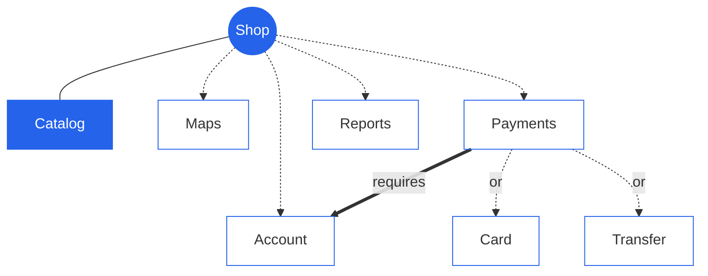

import { Tabs, TabItem, Aside } from '@astrojs/starlight/components';

A **feature model** says which features a product line has and which combinations are allowed. LINEA reads and writes it in **UVL** (Universal Variability Language), a small text format, and shows it as text, as a tree diagram, as XML or as a form. The line keeps it in `models/featuremodel.featuremodel`; each module carries its part as `.linea/model.uvl`.

## A first model

```text title="Feature model, as UVL"
features
    Shop
        mandatory
            Catalog
        optional
            Account
            Maps
            Payments
                or
                    Card
                    Transfer
            Reports

constraints
    Payments => Account
```

The same model as a tree. Solid lines are *mandatory*, dashed lines are *optional*, and the arc under **Payments** means *at least one* of its children (`or`).



## The vocabulary

| Keyword | Meaning | Example |
|---|---|---|
| `mandatory` | In every product | `Catalog` |
| `optional` | A product may include it or not | `Maps` |
| `or` | At least one child must be selected | `Card`, `Transfer` under `Payments` |
| `alternative` | Exactly one child must be selected | `English`, `Spanish` |
| `constraints` | Rules between features anywhere in the tree | `Payments => Account` |

Constraints use logic: `A => B` (A needs B), `A & B`, `A | B`, `!A`. A selection that breaks them is invalid, and LINEA says which one.

## A product is a selection

A product does not copy the model. It **selects** features from it, and LINEA stores the selection as its own model, `featureselection`.

<Tabs>
<TabItem label="Valid">

```text title="NorthClient: featureselection"
Shop
Catalog
Account
Maps
```

</TabItem>
<TabItem label="Invalid">

```text title="Payments without Account"
Shop
Catalog
Payments
Card
```

`Payments => Account` is broken, and `Account` is not selected. The editor flags it and generation refuses it.

</TabItem>
</Tabs>

Mandatory features and the ancestors of a selected feature are *implied*: you do not tick them, but they count.

## Features in the code

The line's code is **annotated** with the feature it belongs to. LINEA keeps a fragment only when its feature is selected.

```js title="src/main.js (line source)"
import { createApp, Catalog } from './core'
/*% if (feature.Account) { %*/
import { SignIn } from './account'
/*% } %*/
/*% if (feature.Maps) { %*/
import { StoreMap } from './map'
/*% } %*/
```

For `NorthClient` (Account and Maps selected) both imports stay. For a product without `Maps` the second one disappears.

## Where the model comes from

| Line type | The feature model is… |
|---|---|
| [Simple SPL and Project](/concepts/line-types/) | **Written by hand** in the line's editor. A new line starts with only the root and must be edited before generating. |
| [Modular](/concepts/line-types/) | **Composed automatically** from the modules. Each module's `model.uvl` is grafted under the root. It is read-only. |

```text title="Composed model of a modular line, excerpt"
features
    FieldService
        mandatory
            WebApplication
                mandatory
                    Tools
                        optional
                            T_MailSender
                        optional
                            T_Swagger
                        optional
                            T_Payments
                                or
                                    T_P_PayPal
                                    T_P_RedSys
                        optional
                            T_FileUploader
```

The features come from the modules: `main-component` brings `WebApplication` and its `Tools`.

<Aside type="tip" title="Three ways to look at it">
In the line's **Models** tab you can switch between **UVL**, a **feature diagram**, **XML** and a **form**. The product's **Configuration** tab shows the same model as a tree of checkboxes.
</Aside>

## Analysing a model

With the [analytics plugin](/configure/plugins/) on, LINEA reports whether the model is **satisfiable**, lists **dead features** (that no valid product can contain), **false optionals** and the **number of configurations**.
