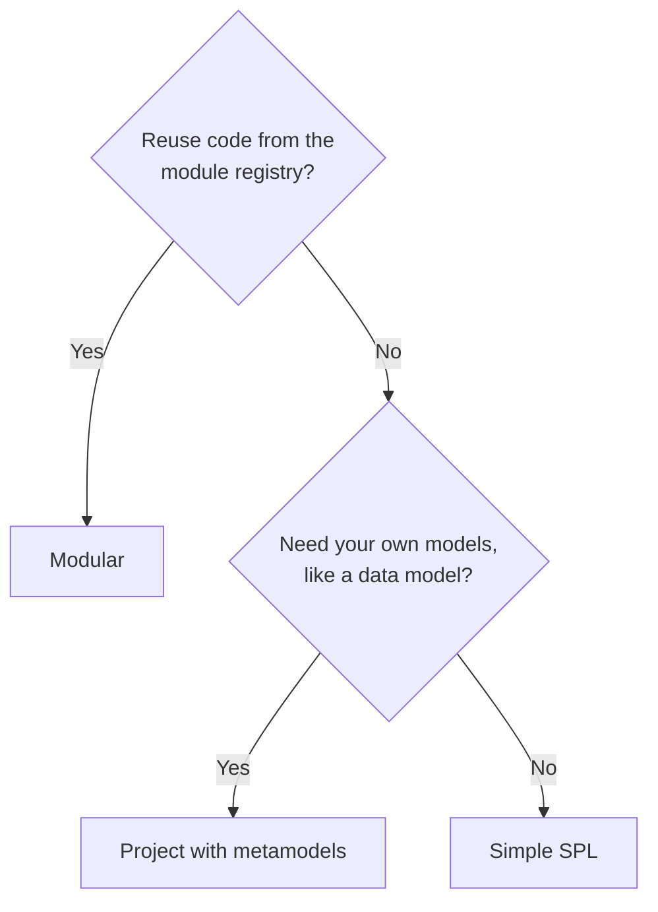

import { Tabs, TabItem } from '@astrojs/starlight/components';

When you create a line you choose its **kind**. The kind decides how much you write yourself. Every kind generates products the same way.

| | Simple SPL | Project | Modular |
|---|---|---|---|
| `kind` | `plain` | `project` | `modular` |
| Feature model | You write it | You write it | **Composed** from modules |
| Platform code | You write it | You write it | **Taken from modules** |
| Metamodels | Only `featuremodel` | You choose | Loaded for you |
| Product models | Feature selection | Selection + your models | Selection + modules' models |
| Best for | Learning, trials | Own models, no modules | **Reuse (recommended)** |

<Tabs>
<TabItem label="Simple SPL">

One repository with a **feature model** and your own **platform code**.

```text title="Repository of a plain line"
spl.json                    kind: plain
linea.lock.json
models/featuremodel.featuremodel
src/platform/
  config.json               ignored files, annotation delimiters
  code/                     annotated application code
  extra.js                  completes the specification
  transformation.js
  ci/                       pipeline templates for products
```

You edit the model by hand:

```text title="Feature model as UVL (stored as models/featuremodel.featuremodel)"
features
    Shop
        mandatory
            Catalog
        optional
            Account
            Maps
```

A new line starts with only its root. And annotate your code with `/*% if (feature.Maps) { %*/ … /*% } %*/`.

**Use it when** you are learning LINEA, trying an idea or keeping a small line.

</TabItem>
<TabItem label="Project">

A simple SPL **plus metamodels** you choose, such as `datamodel`, `forms` or `gui`. Each product describes parts of its app as **models**, and your templates read them.

```json title="spl.json"
{
  "name": "Roads",
  "version": "1.0.0",
  "kind": "project",
  "metamodels": {
    "local:registry/metamodels/featuremodel": "^1.0.0",
    "local:registry/metamodels/datamodel": "^1.0.0",
    "local:registry/metamodels/forms": "^1.0.0"
  },
  "modules": {}
}
```

```text title="A product's datamodel (.linea/models/datamodel.datamodel)"
entity Road {
  property name: String required pk
}
```

LINEA validates each model against its metamodel, gives you text, form and diagram editors, and passes the models to your transformations as `spec.models`.

**Use it when** you need your own models but not reusable modules.

</TabItem>
<TabItem label="Modular">

A line **composed of modules** from the registry. There is no platform code to write.

```json title="spl.json"
{
  "name": "FieldService",
  "version": "1.0.0",
  "kind": "modular",
  "metamodels": {
    "local:registry/metamodels/featuremodel": "^1.0.0"
  },
  "modules": {
    "local:registry/modules/main-component": "^0.4.0",
    "local:registry/modules/user-management-component": "*",
    "local:registry/modules/map-viewer-component": "*"
  }
}
```

Each key is the **location** of a package (`host:path`) and each value a version range.

LINEA resolves versions, pins them in `linea.lock.json`, grafts the modules' feature models under the root, overlays their code and chains their scripts. The result in the feature model:

```text title="Composed feature model (read-only), excerpt"
features
    FieldService
        mandatory
            WebApplication
                mandatory
                    Tools
                        optional
                            T_MailSender
                        optional
                            T_Swagger
                        optional
                            T_Payments
                                or
                                    T_P_PayPal
                                    T_P_RedSys
                        optional
                            T_FileUploader
```

If the composition is invalid (a missing dependency, two modules writing the same file differently), the line cannot be saved and LINEA names the package and file responsible.

**Use it when** you want to reuse functionality across lines. This is the recommended kind.

</TabItem>
</Tabs>

## Choosing



See also [Modules](/concepts/modules/), [Metamodels](/concepts/metamodels/) and [Feature models](/concepts/feature-models/).
