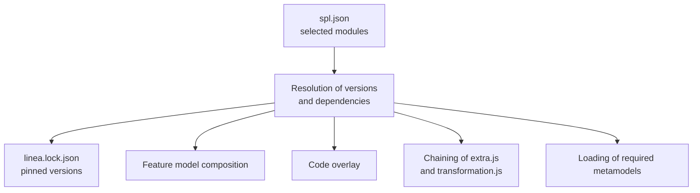

## Definition

A **module** is a reusable package that gives SPLs a complete piece of functionality (user management, map viewer, data management, etc.). A **modular** SPL is built by selecting modules instead of writing all the code.

Each module comprises:

| Element | Location | Role |
|---|---|---|
| Manifest | `.linea/module.json` | Name, version, dependencies (`requires`) and the models it offers (`offers`). |
| Feature model | `.linea/model.uvl` | Features the module adds to the SPL tree (UVL format). |
| Platform configuration | `.linea/config/` (`config.json`, `extra.js`, `transformation.js`) | Code processing and transformation of the product specification. |
| Code | `code/` | Application code annotated with conditions on features. |
| Models | `models/` (optional) | Models the module offers already defined. |

The manifest, model and configuration files live in `.linea/`; `code/` and `models/` stay at the root.

Example `module.json`:

```json
{
  "name": "main-component",
  "version": "0.4.0",
  "description": "Base web application of every product: tools, deployment and transformation of the specification",
  "requires": {
    "modules": {},
    "metamodels": {
      "../../metamodels/basic": "^3.0.0",
      "../../metamodels/featuremodel": "^1.0.0"
    }
  },
  "offers": {}
}
```

Versions are expressed as semantic ranges (`^3.0.0`). Packages refer to each other by folder path (`../common`) or by absolute location (`gitlab:group/package`), which lets the same set of repositories be hosted under any group.

## Annotated code

A module's code is a template: certain fragments are included only if the corresponding feature is selected. Example in a `build.gradle`:

```groovy
/*% if (feature.DM_DI_DF_CSV) { %*/
implementation "com.opencsv:opencsv:4.4"
/*% } %*/
```

If the product includes the `DM_DI_DF_CSV` feature, the dependency is kept; otherwise it is removed. The delimiters vary by file type (`<!--% … %-->` in HTML, `#% … %#` in Python, `###< … >###` in JSON, etc.) and are defined in the platform's `config.json`.

## Registry

- A module is a git repository with the `linea-module` *topic* (metamodels use `linea-metamodel`). Its versions are `vX.Y.Z` tags.
- LINEA keeps no package database: the git server acts as the registry and versions are resolved from tags.
- With `LINEA_REGISTRY`, the listing becomes an explicit catalogue: a `registry.json` file in a repository. Registering or removing a package is a commit made with the user's token; the git server therefore decides who can do it, and its history is the registry's history.
- The catalogue is purely informational: an unregistered package can still be used, and removing one from the catalogue does not affect the SPLs that use it.
- An unreachable entry stays in the listing with the `unavailable` mark.
- The sample `metamodels/` and `modules/` folders are published with `server/scripts/publish-registry.mjs`.

In the interface, the **Modules** section lets you register and remove packages, see suggestions, edit a module's declaration, use the studio, manage files and publish versions.

## Composing an SPL



Rules applied:

1. Each package is used **only once** (a single version). The highest version satisfying all ranges is selected and pinned in `linea.lock.json`, which is kept as long as it remains valid.
2. The modules' feature models are **grafted under the root** of the SPL in a `mandatory` group: every module is present in every product and its features are the options. The constraints of all modules are merged and may relate features of different modules.

   ```text
   features
       FieldService
           mandatory
               WebApplication        // main-component's model.uvl
                   mandatory
                       Tools
                           optional
                               T_Swagger
               UserManagement        // user-management-component's model.uvl
   ```
3. The modules' code is **overlaid**; two modules providing the same file with different content cause an error.
4. `extra.js` and `transformation.js` are **chained** after those of the core.
5. Names are **global**: names of metamodels, features or model elements cannot collide between the packages of an SPL.
6. The models a module offers are validated together with the product's: the product may reference, for example, `UM_User`, but cannot modify it or redeclare its names.

Every problem is reported with the package and file responsible. If the composition is not valid, the SPL cannot be saved.

## Declaring dependencies

A module's page includes a **Declaration** form to state the required metamodels and modules and the offered models, without editing the JSON by hand.

## Sample modules

`main-component`, `user-management-component`, `data-management-component`, `data-browser-component`, `graphical-user-interface-component`, `map-viewer-component`, `sensor-viewer-component` and `mobile-workflow-management-component`.

Technical reference: `linea/docs/modules.md`.
