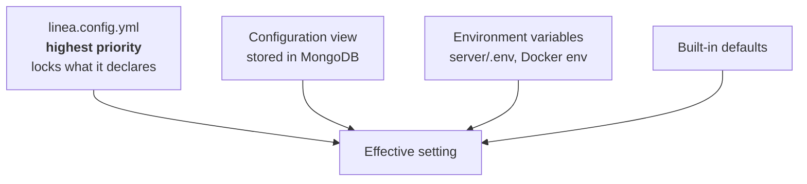

import { Card, CardGrid, LinkCard, Aside, Tabs, TabItem } from '@astrojs/starlight/components';

LINEA is configured in three places. Knowing which one to use for what saves most of the confusion.



## The three places

<CardGrid>
	<Card title="Environment variables" icon="seti:config">
		**Secrets and per-machine values.** The JWT key, OAuth client secrets, ports, URLs. Set in `server/.env` or the Compose `environment:` block. Read at server start.
	</Card>
	<Card title="linea.config.yml" icon="document">
		**What this deployment is made of.** Its git hosts, its plugins and how the instance behaves. Safe to keep in git because secrets stay in the environment as `${VARIABLE}`. Anything it declares is locked in the interface.
	</Card>
	<Card title="Configuration view" icon="setting">
		**Day-to-day choices by an administrator.** Switch a plugin on, add a git host, change the session length. Saved in MongoDB, so it survives restarts, but a file declaration wins.
	</Card>
</CardGrid>

## Order of precedence

From highest to lowest. The first one that defines a value wins.

| # | Source | Locks the value in the interface? |
|---|---|---|
| 1 | **`linea.config.yml`** | Yes, shown as `linea.config.yml` |
| 2 | **Configuration view** (saved in MongoDB) | No |
| 3 | **Environment variables** | No |
| 4 | **Defaults** | No |

For a plugin setting the order is the same: `default` < `environment variable` < `saved in the Plugins view` < `linea.config.yml`.

<Aside type="tip" title="A simple rule">
Put **secrets** in the environment, **structure** (which hosts, which plugins, limits) in `linea.config.yml`, and use the **interface** for anything you want an administrator to change without a deploy.
</Aside>

## What each topic needs

| I want to… | Read |
|---|---|
| Let people sign in with **GitLab** | [Connect GitLab](/configure/gitlab-oauth/) |
| Let people sign in with **GitHub** or GitHub Enterprise | [Connect GitHub](/configure/github-oauth/) |
| Run with **no external git server** | [The local host](/configure/local-host/) |
| Use several hosts together, or choose the primary one | [Git hosts](/configure/git-hosts/) |
| Make someone an administrator, lock accounts | [Users and administrators](/configure/users-and-admins/) |
| Change session length, publishing rights, audit retention | [Instance settings](/configure/instance-settings/) |
| Get notified when a product is generated | [Webhooks and events](/configure/webhooks-and-events/) |
| Control where modules and metamodels come from | [The package registry](/configure/registry/) |
| Turn on analysis or AI agents | [Plugins](/configure/plugins/) |
| Go to production safely | [Production checklist](/configure/production-checklist/) |
| Fix a sign-in or webhook problem | [Troubleshooting](/configure/troubleshooting/) |

## A complete minimal example

<Tabs>
<TabItem label="Trial (local host)">

```ini title="deploy/.env"
PROXY_PORT=9000
REDIRECT_URI=http://localhost:9000
ADMIN_USERS=admin
LINEA_ADMIN_PASSWORD=choose-a-long-password
```

```ini title="server/.env"
JWT_SIGN_KEY=<output of: openssl rand -hex 32>
```

No `linea.config.yml` is needed: with nothing configured, repositories stay on the LINEA server.

</TabItem>
<TabItem label="Team (GitLab)">

```ini title="server/.env"
JWT_SIGN_KEY=<output of: openssl rand -hex 32>
GITLAB_HOSTNAME=https://gitlab.example.com
GITLAB_CLIENT_ID=<Application ID>
GITLAB_SECRET_ID=<Secret>
REDIRECT_URI=https://linea.example.com
ADMIN_USERS=alice,bob
```

```yaml title="deploy/config/linea.config.yml"
gitHosts:
  primary: gitlab
  gitlab:
    url: ${GITLAB_HOSTNAME}
    clientId: ${GITLAB_CLIENT_ID}
    clientSecret: ${GITLAB_SECRET_ID}
    defaultNamespace: linea/spls
plugins:
  analytics-plugin:
    enabled: true
```

</TabItem>
</Tabs>

<Aside type="note">
The file is read once at startup. After changing it, restart the server. A missing path in `LINEA_CONFIG` or invalid YAML stops the server on purpose, so you notice.
</Aside>
