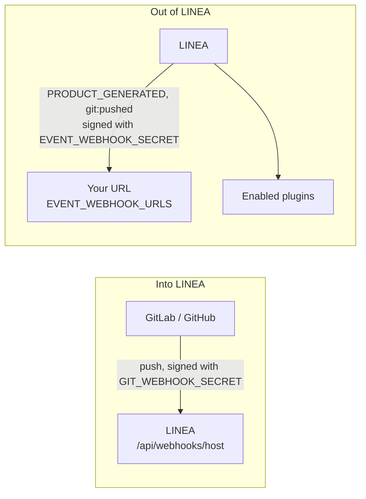

import { Steps, Aside, Tabs, TabItem } from '@astrojs/starlight/components';

There are two directions, with two different secrets.



## Into LINEA: push webhooks

When someone pushes to a repository on GitLab or GitHub, the host can tell LINEA. LINEA turns it into a `git:pushed` event that plugins can react to. The **local** host needs none of this.

<Steps>

1. **Set the public address** the git host can reach LINEA at, and a secret:

   ```ini title="server/.env"
   PUBLIC_URL=https://linea.example.com
   GIT_WEBHOOK_SECRET=<output of: openssl rand -hex 32>
   ```

2. **Ask LINEA to register the hook** on a repository. The registered address is:

   ```text
   <PUBLIC_URL>/api/webhooks/<host>      # gitlab or github
   ```

3. **Check it** on the host: the repository's webhook settings show a hook pointing at that address.

</Steps>

How each host proves a push is genuine:

| Host | Header | Check |
|---|---|---|
| GitLab | `X-Gitlab-Token` | Equal to `GIT_WEBHOOK_SECRET` |
| GitHub | `X-Hub-Signature-256` | HMAC-SHA256 of the body with `GIT_WEBHOOK_SECRET` |

<Aside type="caution">
Without `GIT_WEBHOOK_SECRET`, pushes are **refused**. The host must also be able to reach `PUBLIC_URL` over the network: a LINEA on a laptop cannot receive webhooks from GitLab.com.
</Aside>

## Out of LINEA: domain events

LINEA emits events and can forward them, signed, to URLs you control.

| Event | When |
|---|---|
| `PRODUCT_GENERATED` | A product was generated |
| `git:pushed` | A push reached a repository on any host |

```ini title="server/.env"
EVENT_WEBHOOK_URLS=https://ci.example.com/linea,https://chat.example.com/hook
EVENT_WEBHOOK_SECRET=<output of: openssl rand -hex 32>
```

- `EVENT_WEBHOOK_URLS` is a comma-separated list. Empty means nothing is sent.
- Each delivery is a `POST` whose body is signed with HMAC-SHA256 in the header `X-Linea-Signature: sha256=<hex>`.
- **Without `EVENT_WEBHOOK_SECRET` no event is sent to anyone**, plugins included.
- Enabled plugins that declare a `remote.events` receiver get the same events.

### Verify the signature

Always verify before trusting a delivery. Use the **raw** request body, not a re-serialised one.

<Tabs>
<TabItem label="Node.js">

```js
import { createHmac, timingSafeEqual } from 'node:crypto'

export function isFromLinea(rawBody, header, secret) {
  const expected = 'sha256=' + createHmac('sha256', secret).update(rawBody).digest('hex')
  const a = Buffer.from(expected)
  const b = Buffer.from(header ?? '')
  return a.length === b.length && timingSafeEqual(a, b)
}
```

</TabItem>
<TabItem label="Python">

```python
import hmac, hashlib

def is_from_linea(raw_body: bytes, header: str, secret: str) -> bool:
    expected = "sha256=" + hmac.new(secret.encode(), raw_body, hashlib.sha256).hexdigest()
    return hmac.compare_digest(expected, header or "")
```

</TabItem>
</Tabs>
