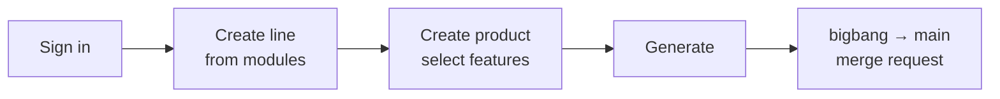

import { Steps, Tabs, TabItem, Aside } from '@astrojs/starlight/components';

This quickstart runs LINEA on your machine with the **`local` git host**: repositories live on the LINEA server, so you need no GitLab or GitHub account. You will sign in, create a line, add a product and generate it.

<Aside type="note" title="What you need">
Docker with Compose. (To run from source instead you need Node.js 22, Git 2.38 or later, and the `linea`, `linea-plugins` and `linea-metamodels` repositories checked out side by side: see [Development setup](/install/development/).)
</Aside>

## 1. Start the stack

<Steps>

1. **Get the Compose files** and set your secrets. The defaults use the `local` git host.

   ```bash
   git clone https://github.com/lbdudc/linea
   cd linea/deploy
   cp .env.example .env     # change JWT_SIGN_KEY and LINEA_ADMIN_PASSWORD
   ```

2. **Start it.** It pulls the published images (`ghcr.io/lbdudc/linea-server` and `linea-client`), MongoDB and a proxy.

   ```bash
   docker compose up -d
   ```

3. **Open** [http://localhost:9000](http://localhost:9000) and sign in as `admin` with the `LINEA_ADMIN_PASSWORD` you set. It is an administrator.

</Steps>

## 2. Create a line

<Steps>

1. Open **Lines → Create SPL**.
2. Enter a name (letters, digits, `.`, `-`, `_`), a version and a description.
3. Choose the kind **Simple SPL**.
4. Save. LINEA creates the line's repository.
5. Open the **Feature model** tab and add a few features under the root (a feature model with only its root cannot be generated).

</Steps>

Not sure which kind to choose? See [Line types](/concepts/line-types/). **Modular** lines (the recommended kind for reuse) are made of modules from a [registry](/configure/registry/): the Docker image carries the metamodels but not the modules, so publish yours first.

## 3. Add a product and generate it

<Steps>

1. In the line, click **Create product** and give it a name and a version.
2. Open the product's **Configuration** tab and tick the features it needs. The tree validates your selection as you go.
3. Click **Generate product**. LINEA derives the code, commits it to the `bigbang` branch and opens a merge request into `main`.
4. Open the product's **Versions & syncs** tab to follow the stages, then merge the `bigbang → main` request on the git host.

</Steps>

## What you just did



## Next steps

- Try a ready-made line: [Start with the calculator example](/get-started/examples/).
- Move to a real git server: [Connect GitLab](/configure/gitlab-oauth/) or [GitHub](/configure/github-oauth/).
- Deploy for a team: [Install with Docker](/install/docker/).
- Learn what happens under the hood: [What happens when a product is generated](/internals/generating-a-product/).
