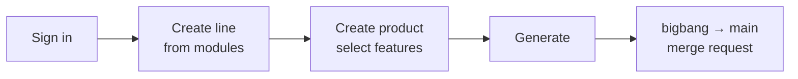

import { Steps, Tabs, TabItem, Aside } from '@astrojs/starlight/components';

This quickstart runs LINEA on your machine with the **`local` git host**: repositories live on the LINEA server, so you need no GitLab or GitHub account. You will sign in, create a line, add a product and generate it.

<Aside type="note" title="What you need">
Node.js 22, Git 2.38 or later, and the LINEA repositories checked out side by side (`linea`, `linea-core`, `linea-git`, `bango` and the registry folders `metamodels/` and `modules/`).
</Aside>

## 1. Start the stack

<Steps>

1. **Go to the server folder** and start MongoDB and the server. The helper script runs both in the background and keeps their data in `server/.dev-data/`.

   ```bash
   cd linea/server
   npm install
   npm run dev:up
   ```

   When it is ready it prints the server address (`http://127.0.0.1:3000`).

2. **Start the web client** in a second terminal. OAuth sends the browser back to the client address, so the client has to run on port `9000`.

   ```bash
   cd linea/client
   npm install
   npx vite --port 9000 --strictPort
   ```

3. **Open** [http://localhost:9000](http://localhost:9000) and sign in with the development account `dev` / `devdevdev`. It is an administrator.

</Steps>

<Aside type="tip">
Another program already uses MongoDB's port 27017? Move it with `MONGO_PORT=27018 npm run dev:up`. `SERVER_PORT` and `CLIENT_PORT` move the server and the client the same way.
</Aside>

## 2. Create a line

<Steps>

1. Open **Lines → Create SPL**.
2. Enter a name (letters, digits, `.`, `-`, `_`), a version and a description.
3. Choose the kind **Modular** and pick `main-component` and `user-management-component`. LINEA reports that the second needs the first and offers a button to add it.
4. Save. LINEA resolves the versions, pins them in `linea.lock.json` and creates the line's repository.

</Steps>

Not sure which kind to choose? See [Line types](/concepts/line-types/).

## 3. Add a product and generate it

<Steps>

1. In the line, click **Create product** and give it a name and a version.
2. Open the product's **Configuration** tab and tick the features it needs. The tree validates your selection as you go.
3. Click **Generate product**. LINEA derives the code, commits it to the `bigbang` branch and opens a merge request into `main`.
4. Open the product's **Versions & syncs** tab to follow the stages, then merge the `bigbang → main` request on the git host.

</Steps>

## What you just did



## Next steps

- Move to a real git server: [Connect GitLab](/configure/gitlab-oauth/) or [GitHub](/configure/github-oauth/).
- Deploy for a team: [Install with Docker](/install/docker/).
- Learn what happens under the hood: [What happens when a product is generated](/internals/generating-a-product/).
