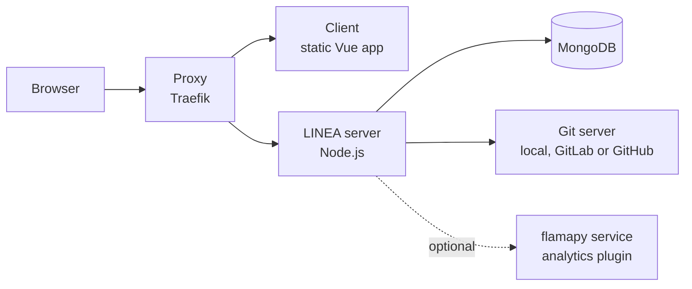

import { Card, CardGrid, LinkCard, Aside } from '@astrojs/starlight/components';

## Requirements

| Needed | Version | Notes |
|---|---|---|
| **Node.js** | 22 | Version 20.0 lacks `Object.groupBy`. Very recent releases (26) break a server dependency. |
| **MongoDB** | 8.x, as a *replica set* | The server uses transactions. Database name `splalm`. The Docker setup creates the replica set for you. |
| **Git** | 2.38 or later | Required by the `local` git host, which checks it at startup. |
| **A git server** | any of three | LINEA's own `local` host, GitLab or GitHub. See [Git hosts](/configure/git-hosts/). |
| Docker | optional | The recommended way to deploy. |
| Python | 3.11+, optional | Only for the flamapy analysis service when you run it outside Docker. |

## Pick an installation

<CardGrid>
	<LinkCard title="Install with Docker" description="MongoDB, server, client and proxy in one compose file. Use this for any shared instance." href="/install/docker/" />
	<LinkCard title="Run the development stack" description="Server and client from source with an in-memory GitLab or GitHub for testing." href="/install/development/" />
</CardGrid>

## What gets installed

| Piece | Role |
|---|---|
| **Proxy** | The only exposed port (`PROXY_PORT`). Routes `/api/`, `/git/` and `/socket.io/` to the server and everything else to the client. |
| **Client** | The Vue web application. |
| **Server** | REST API, the SPL engine and the generation pipeline. |
| **MongoDB** | Accounts, settings, an index of lines and products, generation history. Not the source of truth. |
| **Git server** | The source of truth: lines, products, models and the package registry. |

<Aside type="caution" title="Back up MongoDB and the repositories together">
With the `local` host, accounts and lines live in MongoDB, while code and permissions live in the repositories folder. A backup of only one of them cannot be restored on its own.
</Aside>

After installing, continue with the [configuration overview](/configure/overview/).
