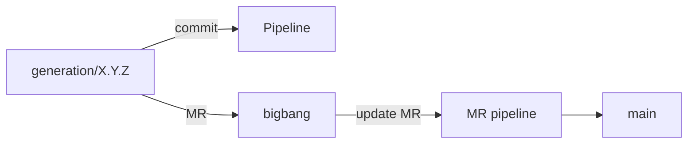

Continuous integration and delivery (CI/CD) are automatic checks that run on every code change. LINEA has two levels: each product's pipeline and the SPL checks.

## Implementation status

| Element | Runs | Status |
|---|---|---|
| Product pipeline: `test_server`, `test_client` (`ci/test-*.sh` scripts) | Every branch and *merge request*, including `bigbang → main` | Implemented |
| Product pipeline: `leftovers`, `spec`, SAST, secret detection, dependency scanning | Same | Developed, pending integration |
| SPL pipeline with `linea-ci` (regenerating and measuring real products) | SPL *merge requests* and nightly runs | In development |

The elements pending integration live in a `git stash` on the working branch and in the `linea-ci` package, which is not yet versioned. Their commands have been tested locally, but **they have not been run on a real GitLab runner**.

## 1. Product pipeline

### Origin
The `.gitlab-ci.yml` template is in `linea-core/src/line/templates/pipeline/` (with a copy on the server). When a `plain` or `project` SPL is created it is added to its platform (`src/platform/code/`), so every generated product inherits it as one more file. `modular` lines get it from their modules. For GitHub there is `github-ci.yml`; the `local` host runs no pipelines.

### Jobs
Stage `test`:

| Job | Image | Command |
|---|---|---|
| `test_server` | `gradle:8-jdk21` | `sh ./ci/test-server.sh`; JUnit reports in `server/build/test-results` |
| `test_client` | `node:20` | `sh ./ci/test-client.sh`; JUnit reports in `client/test-results` |

They run on every *merge request* and every branch. They use a cache (`.gradle`, `client/node_modules`) and keep reports for a week.

### Customisation
The test commands live in `ci/test-server.sh` and `ci/test-client.sh`. By default they run no tests and finish successfully, so a product without tests gets a green pipeline. To add real tests, edit the corresponding script, for example:

```sh
cd server && ./gradlew test
```

Any exit code other than 0 fails the job. The design intends for domain engineers to change the scripts without touching the YAML.

### Relation to the generation workflow



1. The commit on `generation/X.Y.Z` triggers a pipeline.
2. The *merge request* into `bigbang` and, above all, `bigbang → main` run the pipeline. If the project requires a passing pipeline to merge, the merge depends on its result, so `main` only receives code that passed the tests.
3. The product page shows the latest pipeline (status, jobs and, for the failed job, the end of its log). Failed jobs can be retried (*Developer* role) and earlier pipelines can be browsed.

## 2. Extended checks (pending integration)

There is an extended version of the product template that adds:

- A `validate` stage before the tests with two jobs:
  - `leftovers`: detects SPL annotations the engine did not process and that remain in the generated code.
  - `spec`: checks that `.linea/spec.json` is valid JSON and includes the features.
- GitLab security scanning: SAST, secret detection and dependency scanning.
- A `workflow` that runs the pipeline on generation branches, on `bigbang` and on the `bigbang → main` *merge request*, on the merge result. This verifies the state `main` would take, including manual changes and conflict resolution.

Templates under `src/platform/code` are derived together with the product and therefore cannot contain any annotation mark, not even in comments, because the engine would interpret it. An automated test checks this.

## 3. `linea-ci`: SPL verification

`linea-ci` is a standalone package of commands for checks that need processes or network access. Logic that does not need them lives in `linea-core`; `linea-ci` calls `git` and `lizard` and talks to the git server.

| Command | Role |
|---|---|
| `check-leftovers <product>` | Detects unprocessed annotations in a derived product. |
| `validate-specs` | Validates the feature selections of real products against the feature model. |
| `derive` | Derives a product into a directory. |
| `check-determinism` | Derives twice and requires identical results. |
| `fetch-specs` | Fetches the specifications and models of each product in `products.json`. |
| `select-products` | From the files changed in an MR, determines which products to regenerate and which features are affected. |
| `metrics` | Cyclomatic complexity of the generated code (through `lizard`). |
| `mr-metrics` | Compares complexity before and after, per product and per modified feature. |
| `mr-note` | Posts or updates a note on the MR with the results. |

Exit codes: `0` success; `1` the check found problems; `2` incorrect usage.

### Strategy
A change to an SPL's annotated code can affect products nobody has reviewed. The SPL pipeline (template `spl-gitlab-ci.yml`, at the root of the line repository) follows this procedure:

1. **Select** the real products worth regenerating according to what the MR changed.
2. **Derive** those products with the proposed code and with the target branch's code.
3. **Test** and **measure** complexity, attributed to the modified features. A feature that no selected product includes is measured on the smallest product containing it; each feature's contribution is determined by deriving a product with it and without it (ablation).
4. **Comment** the result on the MR.
5. Optionally, nightly runs.

### Environment variables

| Variable | Role |
|---|---|
| `CI_SERVER_URL`, `LINEA_CI_TOKEN` | Reading products and the registry; the token also allows commenting on MRs. |
| `CI_JOB_TOKEN` | Alternative for reading product repositories when `LINEA_CI_TOKEN` is absent. |
| `LINEA_CI_LIZARD` | Command that runs `lizard` (`pip install lizard`). |
| `LINEA_CI_PACKAGE` | Where `linea-ci` is installed from in the pipeline (npm name, git URL or tarball), defined in the group's CI/CD variables. |
| `LINEA_CI_SKIP_LEFTOVERS`, `LINEA_CI_ALLOW_LEFTOVERS` | Skipping or tolerating certain leftover annotations. |

In a line composed of modules, `linea-ci` composes the platform from the git server's registry (the repository has no `model.uvl`) and treats it as a conventional platform.

## 4. Testing LINEA itself

LINEA's code has tests in `linea/server` and `linea/client` (`npm test`), the `linea-core` and `linea-git` suites, and an end-to-end battery in Chrome (`linea/e2e`; `npm install && npm test`). The latter starts one stack per configuration (local only; GitLab only with analytics; GitHub only with hello; all three hosts; and a `linea.config.yml` that locks hosts and a plugin) and walks through it as an administrator and as an ordinary user.
