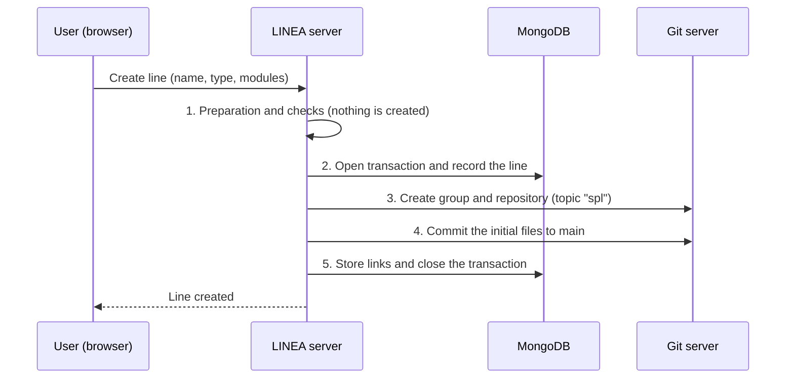

This page describes the internal procedure LINEA runs when it creates a line. The implementation is in `LineService.createLine` (server) and `buildLineScaffold` (`linea-core`).

## Sequence



## Stages

### 1. Identification and host selection
The user's account and the host of their active profile (`local`, `gitlab` or `github`) are located, unless another is given. The user's token on that host is obtained; if they have never signed in to it, the operation fails here, before anything is created.

### 2. Preparation and prior checks (`previewLine`)
The files the line will contain are computed and the validity of the whole is checked:

- The feature metamodel, present in every SPL, is resolved.
- In a `project` line, the selected metamodels are resolved.
- In a `modular` line, the modules are resolved: version selection, dependencies, loading of the required metamodels, validation of the offered models and verification that the composition is possible (strict mode).
- The CI file is determined by the host (GitLab: `.gitlab-ci.yml`; GitHub: `github-ci.yml`; `local`: none, as it runs no pipelines).

Any error happens at this stage, when nothing has been created yet.

### 3. Recording the line and creating the repository
Inside a MongoDB transaction:

1. It checks that no other line has the same name.
2. It saves the line record (name, version, description, type, owner and host).
3. On the git server it creates a group named after the line (under the given parent group or, by default, at the top level) and a repository with the `spl` *topic*.

### 4. Initial files (`main` branch)

| File | Content |
|---|---|
| `spl.json` | Manifest: name, version, type (`plain`, `project` or `modular`), metamodels and direct modules. |
| `linea.lock.json` | The exact versions resulting from resolution. |
| `models/featuremodel.featuremodel` | Initial feature model: only the root, named after the SPL. |
| `products.json` | Product index, initially empty. |
| `src/platform/…` (`plain` and `project` only) | Derivation platform: `config.json` (ignored files and annotation delimiters by extension), `code/.gitignore`, `extra.js`, `transformation.js` and the products' CI pipeline files. |

A `modular` line has no platform of its own: it takes it from its modules at generation time.

### 5. Storing links and closing
The repository ID, the group ID and the URLs (web and Web IDE) are saved in MongoDB, and the transaction is committed.

### Error handling
If something fails, the MongoDB transaction is aborted and whatever was created on the git server is rolled back, so no half-built lines remain. The error detail is written to the server log; the client gets a generic message.

## Result

```
my-spl/                      git group
└── my-spl                   line repository (topic "spl")
    ├── spl.json
    ├── linea.lock.json
    ├── products.json
    ├── models/
    │   └── featuremodel.featuremodel
    └── src/platform/        only in plain and project lines
```

MongoDB ends up with a `Line` document holding the links to the repository. MongoDB is not the source of truth: lines can be rebuilt from the git server with the reconcile operation.

## See also

- Line types: [Getting started](/guides/getting-started/).
- Module resolution: [Modules](/concepts/modules/).
- Product generation: [What happens when a product is generated](/internals/generating-a-product/).
