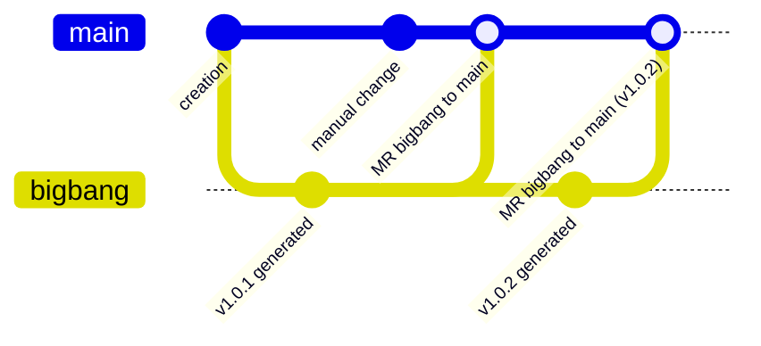
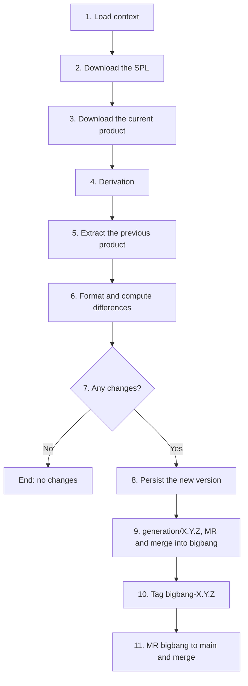

This page describes the generation workflow and the role of the `bigbang`, `main` and `generation/X.Y.Z` branches.

## Before generating: creating the product

Creating a product (`ProductService.createProduct`) performs these operations:

1. It checks that the user has at least the *Reporter* role on the line and that no other product has the same name.
2. It saves the product in MongoDB.
3. On the git server it creates a group (inside the line's group) and a repository (*topic* `product`) whose initial branch is `bigbang`.
4. It creates the `main` branch from `bigbang` and makes it the default branch.
5. It registers the product in the line's `products.json` (name, repository and version).
6. It writes the draft specification `.linea/spec.draft.json` (selected features and basic data).
7. It generates the initial models: `models/featureselection.featureselection` and the starting models of each required metamodel. The specification's feature list becomes an index of that selection, including what the feature model implies.

## Branches

| Branch | Content | Changed by |
|---|---|---|
| `bigbang` | Code exactly as LINEA generates it. | Only LINEA, through automatic *merge requests*. |
| `main` | The current product: generated code plus manual changes. It is the default branch. | Users and LINEA (when merging `bigbang`). |
| `generation/X.Y.Z` | A temporary branch for each generation (`X.Y.Z` is the new version). | LINEA; deleted after the merge. |

**Rationale.** Products can be modified by hand. If LINEA overwrote `main` on every generation, those changes would be lost. By updating only `bigbang` and proposing its merge into `main` through a *merge request*, git combines the generated code with the manual changes and, if conflicts occur, they are exposed for resolution. This is the vendor branch pattern with a three-way merge.

## Stages of generation

The **Generate** action lets you say whether the version bump is *major*, *minor* or *patch* (*patch* by default). The orchestrator is `ProductService.generateProduct` and the stages are implemented in `generatePipeline.js`.

### 1. Load context
The product and the line are read, it is checked that the user has at least the *Maintainer* role on the product and access to the line, and the real specification is read from the repository (`.linea/spec.draft.json`). If the git server does not answer, generation is cancelled rather than use a possibly stale cache. The new version is computed but not yet applied.

### 2. Download the SPL
The line's `.zip` archive is downloaded at a specific *commit*, so a later regeneration gives the same result (same platform and same modules).

### 3. Download the current product
The product's `.zip` is downloaded from `bigbang`, as the reference for comparison.

### 4. Derivation
LINEA composes the platform from the lockfile (pinned modules and metamodels) and the line's own code, validates the product's models and hands them to the transformations as `spec.models`, and runs the SPL engine:

- It keeps or removes each fragment of annotated code according to the selected features (`/*% if (feature.X) { %*/ … /*% } %*/`).
- It applies `extra.js` and `transformation.js` to complete the specification.
- It writes the result to a temporary directory.

If the feature selection violates the feature model, a specific error is raised and the process stops. During this stage the previous version is kept: applying the new one already would make the version text always produce differences and generate empty *merge requests*.

### 5–6. Comparison
The previous product is extracted, the new code is formatted and the difference per file is computed (creation, modification or deletion). The `.linea/` directory is excluded, since it is written by LINEA and not by the generator.

### 7. Checking for changes
- **No differences:** the process ends with “no changes”. The version is not incremented, nothing is tagged and no *merge request* is opened.
- If an earlier run was left incomplete (for example, the code reached `bigbang` but the tag failed), this stage detects it and completes what is pending.

### 8. Persisting the version
Only when a real change is confirmed is the version incremented, regenerated with it and saved in MongoDB.

### 9. Generation branch and merge into `bigbang`
1. `generation/X.Y.Z` is created from `bigbang`.
2. A single commit with the changes is made.
3. A `generation/X.Y.Z → bigbang` *merge request* is opened.
4. It is merged automatically and the branch is deleted.

### 10. Tag
The `bigbang-X.Y.Z` tag is created on `bigbang`. A failure at this step is ignored because it is not critical, and is corrected on the next run.

### 11. Update *merge request* `bigbang → main`
The “Update to product version: X.Y.Z” *merge request* is created, or renamed if one is already open, and an automatic merge is attempted:

- **Merge without conflicts:** `main` takes the new version.
- **Conflicts:** the *merge request* stays open, with a warning and a link, for manual resolution on the git server.
- If the project requires passing CI or approvals, the merge stays pending until they are met.

### Later operations
- `.linea/spec.draft.json` (composed specification) and `.linea/spec.json` (deployed specification, together with the models and the reference of the line *commit* used) are updated.
- The `PRODUCT_GENERATED` domain event is emitted, forwarded with a signature (`X-Linea-Signature`) to the configured webhooks and to the active plugins that receive it.
- On an intermediate failure, what was done in git is rolled back and the temporary files are removed.

## A product's `.linea/` files

| File | Role |
|---|---|
| `.linea/spec.draft.json` | Saved specification (the current selection). |
| `.linea/spec.json` | Deployed specification (the last generated). |
| `.linea/models/<metamodel>.<extension>` | The product's models (in `main`). |
| `.linea/layouts.json` | Position of the diagram nodes. |
| `.linea/product.json` | The product's version and the modules and metamodels it currently resolves to. |

## Common issues

| Situation | What to do |
|---|---|
| “No changes” after an edit | Check that the change affects features or models of the product, that it was saved and that it has an effect on the code. |
| Conflicts in the `bigbang → main` MR | Resolve them on the git server; they usually come from a manual edit to a file the generator also changes. |
| Error reading the specification | The git server is not answering; try again. LINEA prefers failing to generating with stale data. |
| Invalid feature selection | Fix the selection in **Model config**. |
| Line without `spl.json` | An older format that is not supported; it cannot be generated. |
