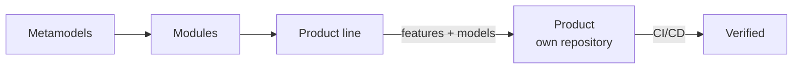

import { Card, CardGrid, LinkCard } from '@astrojs/starlight/components';

**LINEA** keeps all the code your software can have in one repository, annotated by feature, and **generates a separate application for each customer** from the features you pick. This documentation takes you from a first run to a production deployment.

## Start here

<CardGrid>
	<LinkCard title="Quickstart" description="Run LINEA on your laptop and generate a first product in about ten minutes." href="/get-started/quickstart/" />
	<LinkCard title="Install" description="Docker for servers, a dev stack for hacking. Requirements and commands." href="/install/overview/" />
	<LinkCard title="Configure" description="Environment variables, linea.config.yml and the Configuration view." href="/configure/overview/" />
	<LinkCard title="Connect GitLab or GitHub" description="Step-by-step OAuth setup, webhooks and permissions." href="/configure/git-hosts/" />
</CardGrid>

## Find your way

<CardGrid>
	<Card title="I want to try it" icon="rocket">
		Follow the [Quickstart](/get-started/quickstart/). It uses the built-in `local` git host, so you need no GitLab or GitHub account.
	</Card>
	<Card title="I am deploying it for a team" icon="setting">
		Read [Install with Docker](/install/docker/), then [Connect GitLab](/configure/gitlab-oauth/) or [GitHub](/configure/github-oauth/), and finish with the [production checklist](/configure/production-checklist/).
	</Card>
	<Card title="I want to understand it" icon="open-book">
		Read [What is LINEA](/concepts/what-is-linea/), then the three [line types](/concepts/line-types/).
	</Card>
	<Card title="Something does not work" icon="warning">
		Check [Troubleshooting](/configure/troubleshooting/) for sign-in, OAuth and webhook problems.
	</Card>
</CardGrid>

## How the documentation is organised

| Section | What you will find |
|---|---|
| **Get started** | The fastest path from nothing to a generated product. |
| **Install** | Requirements, Docker deployment and the development stack. |
| **Configure** | Every setting, with examples: git hosts and OAuth, users, instance settings, webhooks, registry, plugins. |
| **Concepts** | Lines, modules, metamodels and the three kinds of line. |
| **Guides** | Task-oriented walkthroughs of the workflow. |
| **Internals** | What LINEA does when it creates a line or generates a product, and how CI/CD fits in. |
| **Reference** | Complete tables: environment variables, `linea.config.yml`, glossary. |

:::note
This documentation matches the code on the `refactor/core-boundary` branch (October 2026). Features not yet integrated are marked as such.
:::
